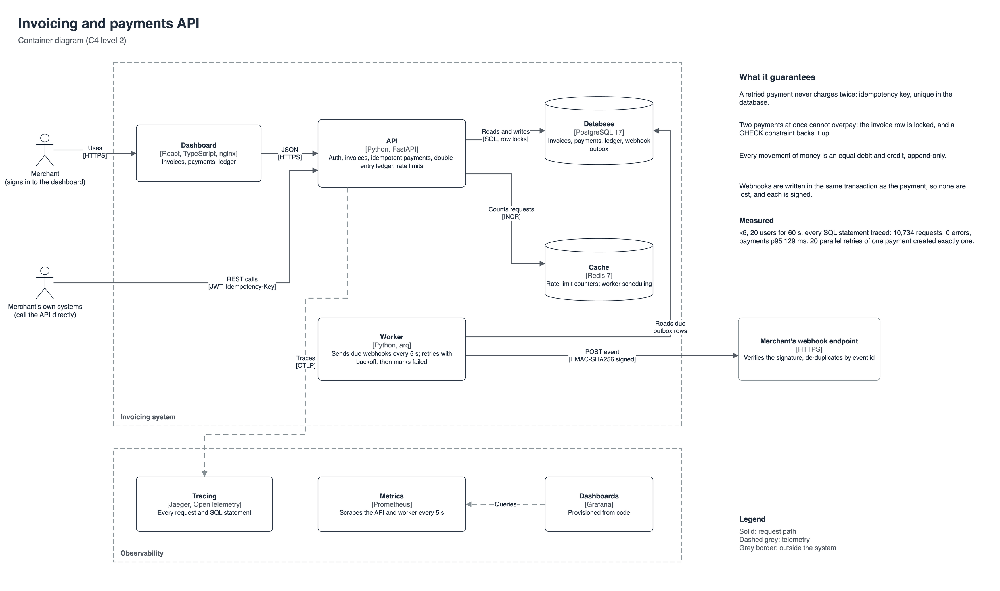
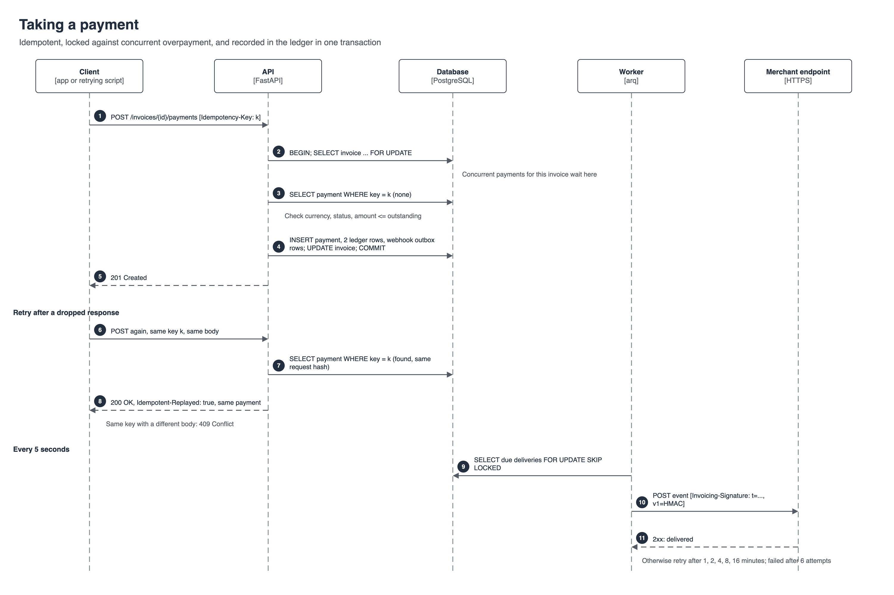
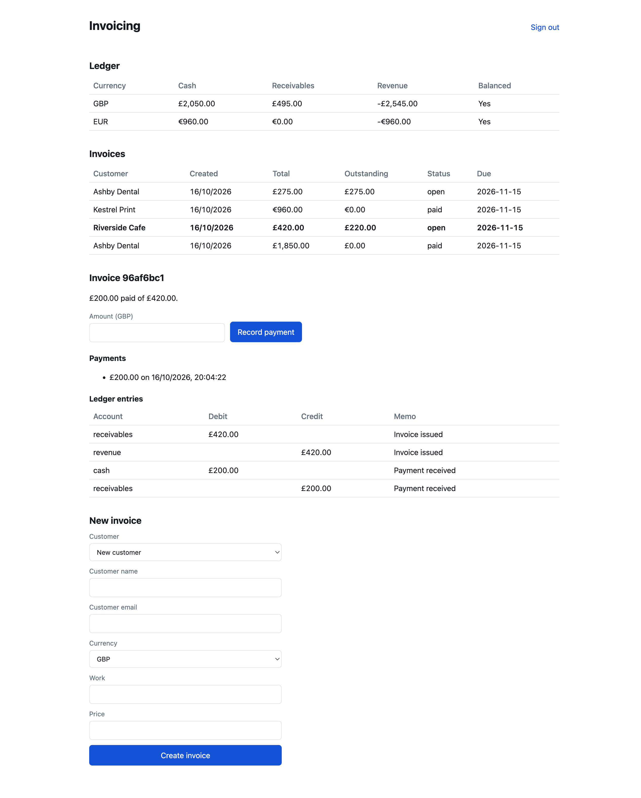

# Invoicing and payments API

[](https://github.com/gumagatsby/invoicing-api/actions/workflows/ci.yml)

A backend for small businesses to invoice customers and record payments, built the way payment systems have to be: a retried request never charges twice, two payments at once cannot overpay an invoice, every movement of money is a balanced ledger entry, and every event reaches the merchant's systems as a signed webhook, even if a server crashes at the wrong moment.

Python, FastAPI, PostgreSQL, Redis, with a React and TypeScript dashboard, OpenTelemetry tracing, Prometheus metrics and Grafana dashboards.



## Measured results

| What | Result |
|---|---|
| Load test (k6, 20 users, 60 s, every SQL statement traced) | 10,734 requests, **0 errors**, payments p95 **129 ms** |
| 20 parallel retries of one payment | exactly **1** payment created, 19 replays |
| 10 parallel full payments on one invoice | exactly **1** accepted, 9 refused |
| Ledger after the load test | debits minus credits = **0** |
| Test suite (real PostgreSQL and Redis) | 20 tests, all passing in CI |

Details and caveats: [`docs/loadtest-results.md`](docs/loadtest-results.md).

## How a payment works



1. The client sends `POST /invoices/{id}/payments` with an `Idempotency-Key`.
2. The API locks the invoice row, so concurrent payments for it queue rather than race.
3. If that key was already used with the same request, the original payment is returned with `Idempotent-Replayed: true`. With a different request, `409 Conflict`.
4. Otherwise it checks currency, status and outstanding balance, then in **one transaction** records the payment, two ledger entries, the invoice update and the webhook deliveries.
5. A worker sends due webhooks every five seconds, signed with HMAC-SHA256, retrying with backoff.

## API

Interactive OpenAPI docs at `http://localhost:8000/docs` when running.

| Method | Path | Purpose |
|---|---|---|
| POST | `/auth/register`, `/auth/token`, `/auth/refresh` | Sign up; OAuth2 password login; rotating refresh tokens |
| POST, GET | `/customers` | Create and list customers |
| POST, GET | `/invoices`, `/invoices/{id}` | Create (total computed from lines); list with cursor pagination and status filter |
| POST | `/invoices/{id}/void` | Void an unpaid invoice with reversing ledger entries |
| POST, GET | `/invoices/{id}/payments` | Take a payment (requires `Idempotency-Key`); list payments |
| GET | `/ledger`, `/ledger/balances` | Entries, and balances per account and currency with a balance check |
| POST, GET | `/webhooks`, `/webhooks/{id}/deliveries` | Register an endpoint (secret shown once); delivery log |
| GET | `/health`, `/metrics` | Health and Prometheus metrics |

## Running it

```bash
cp .env.example .env    # then set APP_JWT_SECRET to a long random value
docker compose up -d --build --wait
```

| Service | URL |
|---|---|
| Dashboard | http://localhost:8081 |
| API docs | http://localhost:8000/docs |
| Grafana | http://localhost:3000 |
| Jaeger | http://localhost:16686 |
| Prometheus | http://localhost:9090 |

Load test: `docker run --rm --network invoicing_default -v "$PWD/loadtest:/scripts" grafana/k6:0.54.0 run /scripts/payments.js` (raise `APP_RATE_LIMIT_PER_MINUTE` first, or the limiter will answer most requests with 429).

## Tests

```bash
docker compose up -d db redis --wait
docker compose exec db psql -U invoicing -c "CREATE DATABASE invoicing_test"
cd api && pip install -r requirements-dev.txt && pytest -q
```

The tests run against real PostgreSQL and Redis because locking, unique constraints and `CHECK` constraints are the behaviour being tested. CI also builds a fresh database from the Alembic migrations and runs `alembic check` to prove they match the models, then starts the whole stack and runs the k6 load test.

## Repository

| Path | What it is |
|---|---|
| [`api/app`](api/app) | FastAPI app: routes, models, payment and webhook services, worker, telemetry |
| [`api/tests`](api/tests) | Auth, billing, concurrency, ledger, pagination, rate limit and webhook tests |
| [`api/migrations`](api/migrations) | Alembic migrations |
| [`web`](web) | React and TypeScript dashboard (Vite, served by nginx) |
| [`ops`](ops) | Prometheus config and the provisioned Grafana dashboard |
| [`loadtest`](loadtest) | k6 script |
| [`docs`](docs) | Diagrams, decisions, load test results, walkthrough |

See [docs/decisions.md](docs/decisions.md) for why each choice was made and what production would add.


