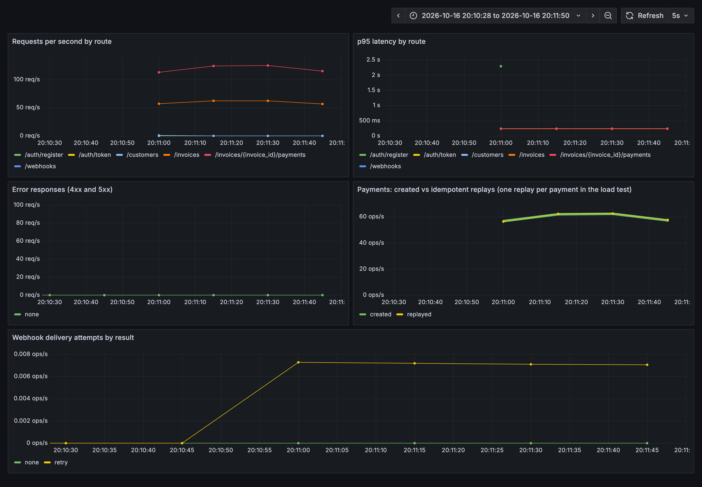

# Load test results

Run on 16 October 2026 with [`loadtest/payments.js`](../loadtest/payments.js) (k6 0.54.0) against the Docker Compose stack: one API process (uvicorn, single worker), PostgreSQL 17, Redis 7, with OpenTelemetry tracing every request and every SQL statement. Machine: Apple M1 Max, 10 cores, 64 GB, Docker Desktop. The rate limit was raised for the run so the test measures the API, not the limiter.

**Workload:** 20 virtual users for 60 seconds. Each iteration creates an invoice, pays it in full, then replays the payment with the same idempotency key, as a client retrying after a dropped response would.

| Measure | Result |
|---|---|
| Requests | 10,734 (178 per second) |
| Failed requests | 0 (0.00%) |
| Checks passed | 10,674 of 10,674 |
| Latency, all requests | p50 107 ms, p95 128 ms, p99 148 ms |
| Latency, payments | p50 108 ms, p95 129 ms, p99 144 ms |
| Threshold: payments p95 under 300 ms | Passed |

**Database afterwards:** no invoice paid more than once, ledger debits minus credits = 0, and no invoice marked open while fully paid.

**What tracing costs.** Earlier runs on the same machine traced HTTP but, because of an instrumentation version mismatch, not SQL. They managed 224 to 226 requests per second with payments at p95 102 to 105 ms. Tracing every SQL statement costs about a fifth of throughput and 25 ms at p95. In production that is the case for sampling traces (say 10%) rather than recording all of them.

**Sign-in is slow on purpose.** When all 20 users registered and logged in at once at the start, those requests reached about 2.3 s at p95. Argon2 password hashing is designed to be expensive so stolen hashes are slow to crack; it runs once per session, not per request.

These numbers are for one laptop and one API process. They show correctness under load and give a baseline, not a capacity plan. Scaling out is more API replicas behind a load balancer, which the Redis rate limiter and the database locks already support.
